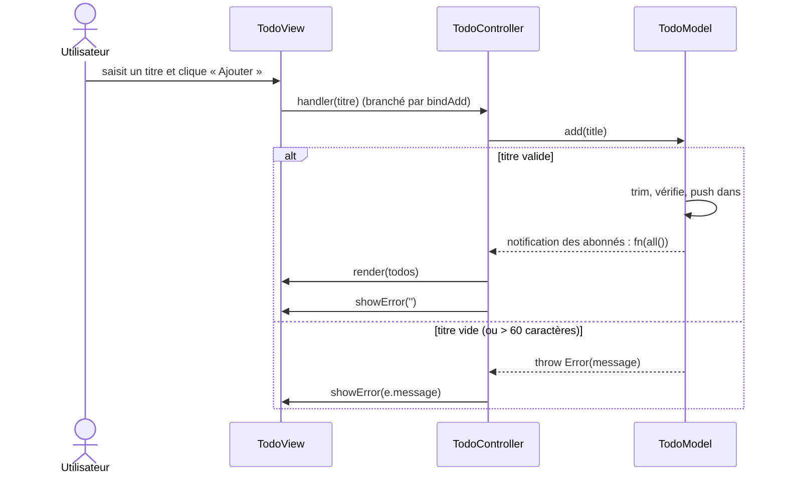
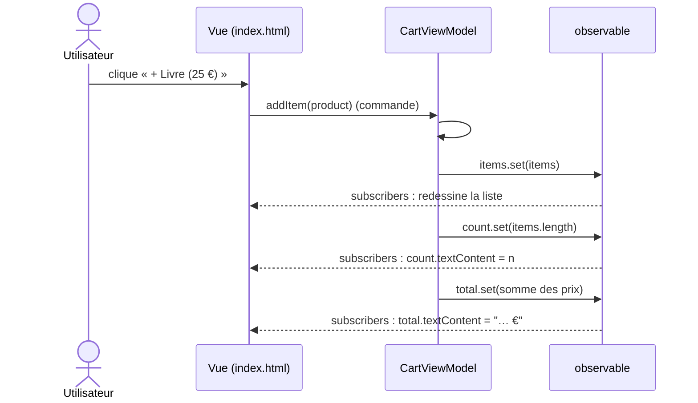

# TP 1 · Séquences MVC / MVVM (parcours Data)

Auteure : Nouamane Dahour · Date : 2026-10-21

## Étape 1 · Observations

| Question | MVC (Todo) | MVP (Connexion) | MVVM (Panier) |
|---|---|---|---|
| Quel fichier reçoit le clic de l'utilisateur ? | `TodoView.js` : `bindAdd` écoute le `submit` du formulaire (et `render` branche `onchange` / `onclick` des cases et boutons). Il transmet au Controller. | `index.html` (la vue passive) : `login.addEventListener('submit', …)` appelle `presenter.onSubmit()`. | `index.html` : `b.onclick = () => vm.addItem(p)` appelle directement le ViewModel. |
| Quel fichier contient la règle de validation ? | `TodoModel.js` : « Le titre est obligatoire » (et « 60 caractères maximum » après l'étape 3). | `LoginPresenter.js` : e-mail avec `@`, mot de passe de 4 caractères minimum. | Aucune validation de saisie dans cet exemple. `CartViewModel.js` ne fait que calculer `count` et `total`. |
| Qui met l'écran à jour, et comment ? | Le **Controller** : `model.subscribe(todos => view.render(todos))` ; les erreurs passent par `view.showError(…)`. | Le **Presenter** appelle explicitement `view.showError`, `showSuccess`, `setLoading`. | **La vue elle-même**, par liaisons : `vm.total.subscribe(…)` ; elle est rappelée automatiquement à chaque `set()` d'une observable. |
| Combien de tests ? Ont-ils besoin du navigateur ? | 3 tests sur `TodoModel` (5 avec les 2 tests de la règle des 60 caractères). **Pas de navigateur.** | 3 tests sur `LoginPresenter`, avec une fausse vue. **Pas de navigateur.** | 2 tests sur `CartViewModel`. **Pas de navigateur.** |

*Vérifié par :* `node --test seance1-presentation/mvc/TodoModel.test.js` (3 pass), `…/mvp/LoginPresenter.test.js` (3 pass), `…/mvvm/CartViewModel.test.js` (2 pass), `node seance1-presentation/mvp/demo.js` (même Presenter piloté par une vue console).

## Étape 2 · Diagrammes de séquence « l'utilisateur ajoute une tâche »

### MVC (Todo-list)

### MVVM (Panier)

**Différence principale (deux phrases).** En MVC, c'est le Controller qui orchestre : il reçoit l'action de la vue, appelle le modèle, puis demande lui-même à la vue de se redessiner. En MVVM, il n'y a plus de chef d'orchestre : la vue appelle une commande du ViewModel puis se met à jour toute seule, car elle est abonnée aux observables.

## Étape 3 · Pourquoi le message s'affiche sans toucher à la View ni au Controller

La règle est dans `TodoModel.add` qui lève `Error('60 caractères maximum')` ; le Controller attrape **n'importe quelle erreur** du modèle (`catch (e) { view.showError(e.message) }`) et la View affiche simplement le texte reçu : ils ne connaissent pas la règle, ils transportent son message.

*Vérifié par :* `node --test seance1-presentation/tp1-dahour/TodoModel.regle.test.js` (2 pass) ; `diff` de `TodoView.js` et `TodoController.js` avec ceux de `mvc/` : identiques ; un faux écran branché sur le vrai Controller reçoit bien `showError("60 caractères maximum")`.
