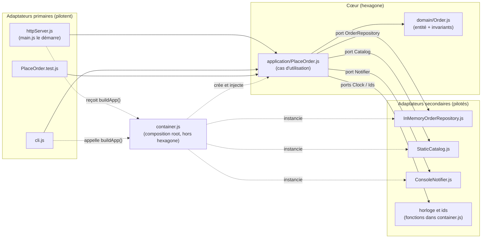

# TP 2 · Hexagone de ShopLite (parcours Data)

Auteure : Nouamane Dahour · Date : 2026-10-21

## Étape 1 · Les trois portes

| Porte | Résultat obtenu (code HTTP, message, total…) |
|---|---|
| Ligne de commande (`node seance2-architecture/hexagonal/cli.js C-42 CLAVIER:2 SOURIS:1`) | `[e-mail simulé] Commande CMD-0001 confirmée pour C-42 : 117 €` puis `Commande créée : {"id":"CMD-0001",…,"total":117,…}` |
| HTTP : commande valide | `201 Created`, `id` CMD-0001, `total` 117 |
| HTTP : relecture de la commande | `GET /orders/CMD-0001` : `200 OK`, la même commande |
| HTTP : produit inconnu | `400 Bad Request` : `{"error":"Produit inconnu : TELE"}` |
| HTTP : commande vide | `400 Bad Request` : `{"error":"Une commande doit contenir au moins une ligne"}` |
| Tests (`node --test …/PlaceOrder.test.js`) | **3 tests**, 3 réussis, 0 échec. **Aucun serveur nécessaire** (ports sortants simulés) |

**Identique / ce qui change (3 lignes)**

- Identique : la même classe `PlaceOrder` et le même `Order` sont exécutés, avec les mêmes règles (produit inconnu refusé, commande vide refusée, total 117 €).
- Ce qui change : seule l'entrée (arguments de la ligne de commande, requête HTTP, appel de test) et la façon de présenter le résultat (texte console, code HTTP + JSON, assertion).
- Le cœur ne sait pas qui l'appelle : c'est le rôle des adaptateurs primaires de traduire.

## Étape 2 · L'hexagone

Notes de lecture :

- Les flèches pleines sont les appels à l'exécution ; les flèches pointillées sont le câblage (qui crée quoi).
- Les ports `OrderRepository`, `Catalog`, `Notifier`, `Clock`, `Ids` sont des **contrats implicites** (JavaScript n'a pas d'`interface`) : ils sont décrits en commentaire en tête de `PlaceOrder.js`.
- `PlaceOrder.test.js` crée ses propres faux ports et n'utilise pas `container.js`.

**container.js : où le placer, et pourquoi ?** À l'extérieur de l'hexagone, au-dessus de tout : c'est la composition root, le seul endroit qui connaît à la fois le cas d'utilisation et les adaptateurs concrets (il fait les `new`), pour que le cœur n'en connaisse aucun.

**Règle de dépendance :** les dépendances de code vont toujours de l'extérieur vers l'intérieur (adaptateurs → application → domaine) ; le domaine n'importe rien, et le cas d'utilisation ne connaît les adaptateurs que par leurs ports.
