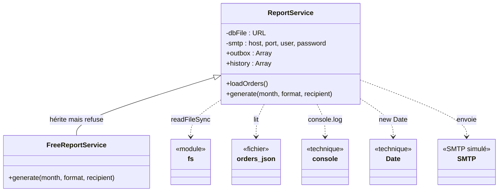
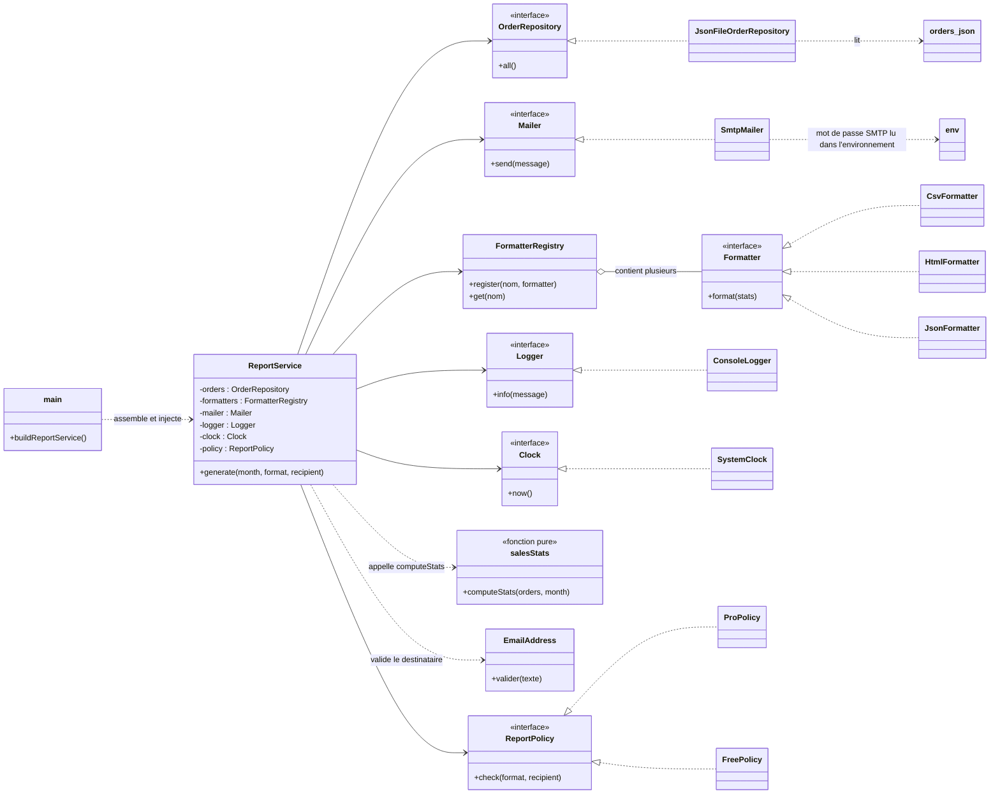

# TP 3 · Diagrammes de classes (parcours Data)

## 1. L'existant : `ReportService` (God class)

`generate()` calcule, met en forme (3 formats en `if`), journalise et envoie : 5 responsabilités dans une classe qui crée elle-même fichier, console, date et SMTP.

## 2. La cible : un refactoring complet

La composition root `main.js` est le seul fichier qui fait des `new` d'adaptateurs ; `ReportService` ne dépend que des interfaces (`OrderRepository`, `Mailer`, `Logger`, `Clock`, `Formatter`, `ReportPolicy`).

### La cible respecte-t-elle les 5 principes ?

| Principe | Comment la cible le respecte |
|---|---|
| S | Une classe par responsabilité : calcul (`salesStats`), formats (un `Formatter` par format), lecture (`OrderRepository`), envoi (`Mailer`), journal (`Logger`), règle d'adresse (`EmailAddress`). |
| O | Un nouveau format = une nouvelle classe `Formatter` enregistrée dans `FormatterRegistry` ; `ReportService` n'est pas rouvert. |
| L | Plus d'héritage qui refuse : l'offre gratuite est une `FreePolicy` qui implémente `ReportPolicy`, injectée, et `ReportService` reste le même pour tous. |
| I | De petites interfaces à une méthode (`all`, `send`, `info`, `now`, `format`, `check`) : chaque client n'utilise que ce dont il a besoin. |
| D | `ReportService` dépend d'abstractions ; le fichier, le SMTP, la console et l'horloge sont des détails branchés par `main.js` ; le mot de passe SMTP vient de l'environnement. |

### Ce que j'ai réellement implémenté (parcours Data : une seule extraction)

`salesStats` (le calcul), injecté dans `ReportService` par le constructeur : `new ReportService({ computeStats })`. Le reste du diagramme est la cible à atteindre (parcours Dev), pas du code livré.
